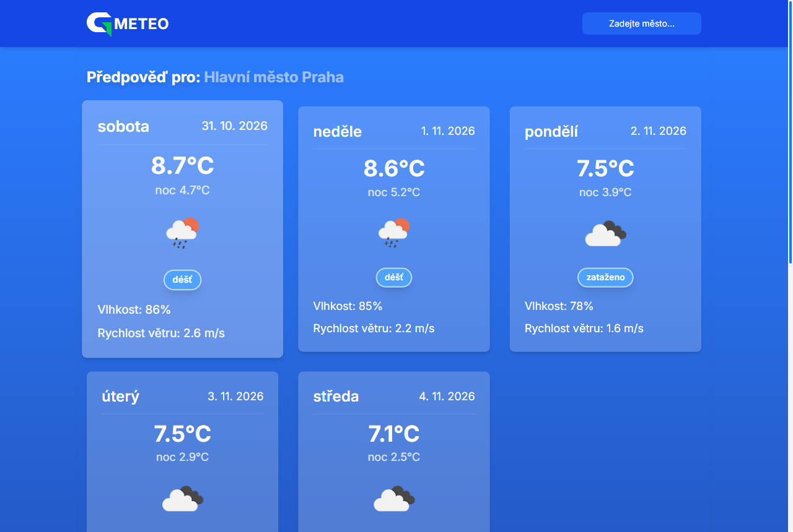

# Gmeteo

Předpověď počasí na 5 dní pro libovolné město na světě. Po otevření ukáže Prahu, a pokud povolíte polohu, přepne se na místo, kde jste. Jiné město najdete přes vyhledávání v hlavičce.

Aplikace běží na [g-meteo-eight.vercel.app](https://g-meteo-eight.vercel.app).



## Co umí

- předpověď na 5 dní: denní a noční teplota, vlhkost, vítr a ikona počasí
- graf s průběhem maximálních a minimálních teplot
- vyhledávání ve zhruba 200 000 městech, funguje i bez diakritiky („usti“ najde Ústí nad Labem)
- ovládání vyhledávání z klávesnice (šipky, Enter, Esc)

## Technologie

Next.js 16 (App Router), React 19, TypeScript, Redux Toolkit, Tailwind CSS 4 a Chart.js. Data o počasí jsou z [OpenWeatherMap](https://openweathermap.org/).

Předpověď i vyhledávání měst jdou přes API routy v Next.js (`app/api/forecast`, `app/api/cities`). API klíč tak zůstává na serveru a prohlížeč nemusí stahovat celý seznam měst, který má přes 40 MB.

## Spuštění

Potřebujete Node.js 20.9 nebo novější, [pnpm](https://pnpm.io/) a API klíč z OpenWeatherMap (stačí bezplatný).

```bash
git clone https://github.com/PetrGrabovsky/g-meteo.git
cd g-meteo
pnpm install
cp .env.example .env.local
```

Do `.env.local` doplňte svůj klíč do `WEATHER_API_KEY` a spusťte vývojový server:

```bash
pnpm dev
```

Aplikace poběží na [localhost:3000](http://localhost:3000).

Další skripty: `pnpm build` (produkční build), `pnpm lint`, `pnpm typecheck` a `pnpm format`.

## Struktura projektu

```
app/          stránka, layout a API routy
components/   hlavička s vyhledáváním, karty s předpovědí a graf
data/         seznam měst z OpenWeatherMap
hooks/        detekce mobilu a scrollování
store/        Redux store: slices a thunky pro polohu, počasí a vyhledávání
utils/        typy, metadata a pomocné funkce
```

## Autor

Petr Grabovský, [GitHub](https://github.com/PetrGrabovsky)
